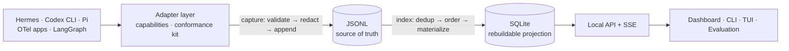

# agent-trace

[English](README.md) · [中文](README.zh-CN.md)

**Local-first observability & evaluation for AI agents.** Trace, debug and
evaluate your agents — and keep the data on your machine.

Every model call, tool execution, subagent and failure lands in a local JSONL
stream, gets indexed into SQLite, and can be read four ways: a CLI, a live TUI
panel, a browser dashboard, and an evaluation harness that turns past runs into
repeatable tests. Works with **Hermes**, **Codex CLI**, **Pi**, **anything that
speaks OpenTelemetry**, and **LangChain/LangGraph**. No proxy, no cloud, no
account.

```bash
bash install.sh all              # adapters + CLI
agenttrace serve --daemon        # indexer + API + dashboard on 127.0.0.1:8741
```

## Quick start

```bash
bash install.sh hermes [profile|all]   # or: pi | codex | cli
hermes chat -q "Reply with exactly: OK"

agenttrace ls                      # recent records
agenttrace watch                   # the same traffic, live
agenttrace session <id>            # one conversation, every turn timed
agenttrace report                  # efficiency signals across recent runs
agenttrace serve                   # the dashboard
```

## Architecture



Three boundaries do the real work:

* **The contract is the wire format** (`schema/events.schema.json`), not an
  interface. The Pi adapter is TypeScript inside Pi's process and conforms
  without importing any of this; `adapter_sdk/testing.py` checks emitted
  streams, whatever language produced them.
* **Redaction happens at capture time**, in the adapter, before a value reaches
  disk. There is no path that writes first and scrubs later.
* **JSONL is truth, SQLite is derived.** A corrupt or stale index is rebuilt,
  never repaired — which is also how a converter change reaches traces that were
  already indexed (`agenttrace index --full`).

Shared code (`common/`, `core/`, `adapter_sdk/`) imports the standard library
only: the deployed Hermes plugin is a copy of one file running inside someone
else's process, where a third-party import is a version bomb.

## Commands

| | |
|---|---|
| `agenttrace ls` / `show` / `search` | recent records · one call in full · grep across content |
| `agenttrace sessions` / `stats` | group by session · calls, tokens, errors per agent/model |
| `agenttrace session <id>` | a conversation: every turn with its own duration |
| `agenttrace report` | trajectory signals — retry loops, error recovery, context growth |
| `agenttrace watch` | live full-screen panel while the agent runs |
| `agenttrace serve` | indexer + local API + dashboard (`--daemon`, `--status`, `--stop`) |
| `agenttrace index [--full]` | (re)build the SQLite index from the JSONL files |
| `agenttrace adapter list\|test\|coverage` | registry · conformance kit · capture gaps |
| `agenttrace otlp import\|export` | OTLP in and out |

Filters (`--agent --model --event --session --since --contains --limit`) and the
environment variables are in **[docs/usage.md](docs/usage.md)**.

## Dashboard

`agenttrace serve --daemon` indexes every known trace dir and serves
`http://127.0.0.1:8741` with a one-time token in the startup line. Updates
arrive live over SSE.

**Overview** (errors, tokens, latency) · **Traces** (search and filter) ·
**Trace detail** (execution tree + waterfall, span input/output/errors, the
workspace, raw JSON) · **Sessions → Session detail** (each turn's duration, its
share of agent time, and where the gaps were) · **Datasets / Experiments** ·
**Adapters** (declared capabilities vs. observed data, ingest health, gaps).

A trace is **one turn** — that is what "one task execution" means — which is why
per-conversation time lives on the session page.

## Evaluation

```bash
agenttrace report --limit 100 --verbose
```

Turn a bad trace into a regression test and score a whole set: a dataset holds
the task and expected outcome (pointers, not a copy of the prompt history), an
experiment pins the dataset version, evaluator versions and agent config, and
runs use **playback** scoring — they score recorded executions rather than
re-running the agent.

| evaluator kind | examples |
|---|---|
| deterministic | tests pass · output contains X · budget respected · **the agent claimed success while the last test run failed** |
| trajectory | repeated failing calls · error recovery · context growth without progress · time to first action |
| LLM-as-judge | task completion, judged by a **local** endpoint (unconfigured ⇒ reported as "no signal", never a fake verdict) |

Signals are never summed into one score: a retry loop can be the correct
recovery. Cost is `unknown` for unpriced models rather than estimated.

## Adapters

Five ship: **hermes**, **codex**, **pi**, **otlp**, **langgraph**. Capabilities
are declared at four levels — `supported`, `partial`, `unsupported`, `unknown` —
so a gap reads as "this adapter did not provide this field" rather than as an
empty string. Codex, for instance, declares `streaming: unsupported` because its
rollout file is written after completion.

Third-party adapters are found via a manifest or an entry point **without being
imported**; code runs only when you explicitly ask. See
[docs/adapters.md](docs/adapters.md) and
[docs/writing-an-adapter.md](docs/writing-an-adapter.md).

## "I installed it and nothing shows up"

An adapter loads when its host process starts, so it does nothing for a session
that is already running — restart the agent, or `/reload` in Pi. The dashboard
says so itself:

```bash
agenttrace adapter coverage         # what is missing, and why (exit 1 on a gap)
```

It compares the sessions each agent left artefacts for against the sessions we
hold traces for, split by age against the adapter's install time: after the
install is a defect, before it is a backfill candidate.

```bash
python3 pi/pi_import.py             # Pi: recover sessions with no live traces
python3 codex/codex_import.py <rollout.jsonl>
```

Backfilled records are labelled and namespaced so they are never mistaken for
observed ones, and the request side is rebuilt from the transcript — and says so.

## Privacy

* Nothing leaves the machine: no cloud, no account, no telemetry.
* Redaction happens in the adapter, before disk (`AGENTTRACE_REDACT=0` disables
  it); `AGENTTRACE_CAPTURE=metadata` keeps structure and drops bodies.
* The local API is **not** implicitly trusted: loopback bind, `Host` allowlist
  (DNS rebinding), no CORS headers, `Origin` check, bearer token at mode 0600.
* Workspace capture is read-only and never takes your git index lock; diffs are
  off by default (`AGENTTRACE_GIT=full` opts in) and the snapshot records when it
  looked, so a months-old trace is not read against today's branch.

Deliberately not here yet: retention/auto-delete policies, deleting a single
trace or session, real agent replay (playback only), cross-machine aggregation.
The reasoning behind each decision is in [docs/decisions.md](docs/decisions.md).

## Development

```bash
test/run-all.sh                    # everything (SKIP_E2E=1 to skip real model calls)
.venv/bin/ruff check . && .venv/bin/mypy
cd pi && npm ci && npm run typecheck
```

~29 test files: per-adapter fixtures, the conformance kit, dashboard routing,
the two end-to-end tests, and `test/review-fixes.test.py`, which holds every
finding from the review rounds — including the ones the fixes themselves
introduced. CI runs lint, types and the suite on every push.

## Docs

| | |
|---|---|
| [architecture.md](docs/architecture.md) | the six layers and the boundaries between them |
| [schema.md](docs/schema.md) | the canonical event model, field by field |
| [usage.md](docs/usage.md) | every flag, filter, environment variable and file path |
| [adapters.md](docs/adapters.md) | the five adapters, capabilities, coverage, recovery |
| [writing-an-adapter.md](docs/writing-an-adapter.md) | how to add one, and how it will be checked |
| [examples.md](docs/examples.md) | runnable starting points |
| [decisions.md](docs/decisions.md) | every architectural decision, with its reasoning |
