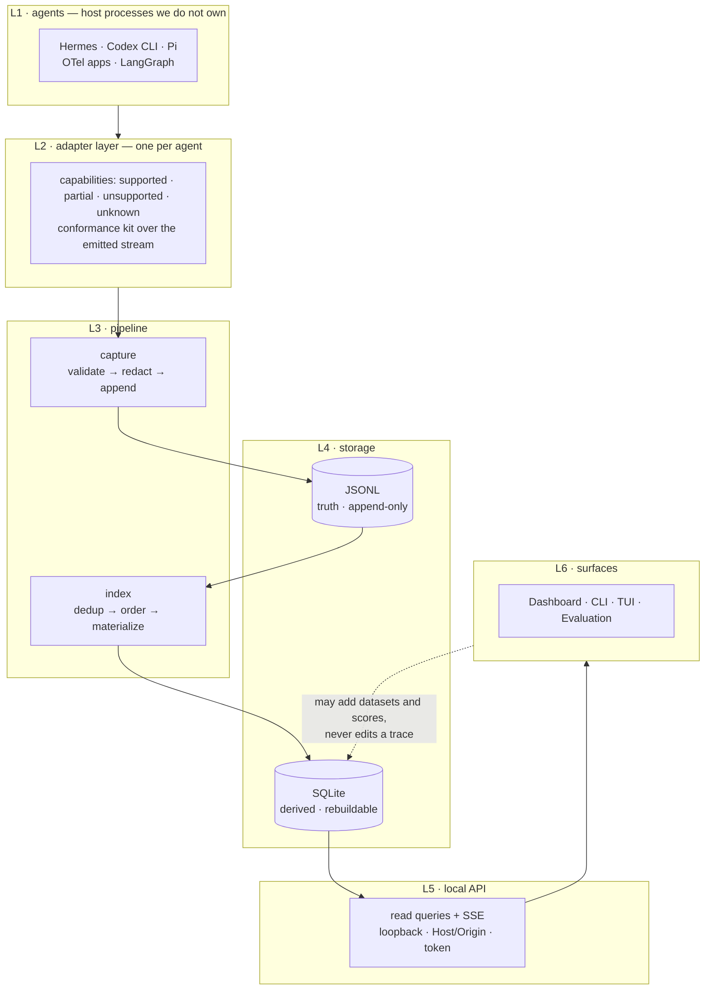

# agent-trace

[English](README.md) · [中文](README.zh-CN.md)

**Local-first observability & evaluation for AI agents.** Trace, debug and
evaluate your agents — and keep the data on your machine.

Every model call, tool execution, subagent and failure lands in a local JSONL
stream, gets indexed into SQLite, and can be read four ways: a CLI, a live TUI
panel, a browser dashboard, and an evaluation harness that turns past runs into
repeatable tests. Works with **Hermes**, **Codex CLI**, **Pi**, **anything that
speaks OpenTelemetry**, and **LangChain/LangGraph**. No proxy, no cloud, no
account.

```bash
bash install.sh all              # adapters + CLI
agenttrace serve --daemon        # indexer + API + dashboard on 127.0.0.1:8741
```

## Quick start

```bash
bash install.sh hermes [profile|all]   # or: pi | codex | cli
hermes chat -q "Reply with exactly: OK"

agenttrace ls                      # recent records
agenttrace watch                   # the same traffic, live
agenttrace session <id>            # one conversation, every turn timed
agenttrace report                  # efficiency signals across recent runs
agenttrace serve                   # the dashboard
```

## Architecture



The arrow that does not exist is the important one: **nothing writes back into the
trace stream.** Datasets and scores are separate tables; a recorded execution is
immutable, which is what makes an experiment reproducible months later.

## Architecture principles

Each of these is enforced somewhere in the code, not just intended — the right
column names where.

| principle | in practice |
|---|---|
| **Local-first** | nothing leaves the machine: no cloud, no account, no telemetry. Loopback bind, `Host` allowlist, no CORS, `Origin` check, bearer token at 0600 (`server/main.py`) |
| **The contract is the wire format** | `schema/events.schema.json`, not a language interface. The Pi adapter is TypeScript and conforms without importing any of this; the kit checks emitted streams (`adapter_sdk/testing.py`) |
| **JSONL is truth, the index is derived** | a corrupt or stale index is rebuilt, never repaired — which is also how a converter change reaches already-indexed traces (`core/storage/`, `agenttrace index --full`) |
| **Redact before disk** | redaction runs inside the adapter, before the append. There is no path that writes first and scrubs later (`core/privacy.py`, `common/agenttrace_common.py`) |
| **Capture fails open** | one lost event is acceptable; a blocked agent is not. The sink swallows I/O errors and counts them (`adapter_sdk/event_sink.py`) |
| **Capability honesty** | four levels, and an absent field renders as "this adapter did not provide it", never as an empty string (`adapter_sdk/capabilities.py`) |
| **Evidence, not scores** | evaluators return evidence and confidence; trajectory signals are reported separately and never summed (`evaluation/`) |
| **Fail visibly** | an empty dashboard must explain itself: coverage gaps, "index still building", and errors that name the route they came from (`core/coverage.py`, `server/static/app.js`) |

The reasoning behind each, including the ones that were reversed after review,
is in [docs/decisions.md](docs/decisions.md).

## Commands

| | |
|---|---|
| `agenttrace ls` / `show` / `search` | recent records · one call in full · grep across content |
| `agenttrace sessions` / `stats` | group by session · calls, tokens, errors per agent/model |
| `agenttrace session <id>` | a conversation: every turn with its own duration |
| `agenttrace report` | trajectory signals — retry loops, error recovery, context growth |
| `agenttrace watch` | live full-screen panel while the agent runs |
| `agenttrace serve` | indexer + local API + dashboard (`--daemon`, `--status`, `--stop`) |
| `agenttrace index [--full]` | (re)build the SQLite index from the JSONL files |
| `agenttrace doctor` | why is nothing showing up: install, capture, disk, dropped events, index |
| `agenttrace adapter list\|test\|coverage` | registry · conformance kit · capture gaps |
| `agenttrace otlp import\|export` | OTLP in and out |

Filters (`--agent --model --event --session --since --contains --limit`) and the
environment variables are in **[docs/usage.md](docs/usage.md)**.

## Dashboard

`agenttrace serve --daemon` indexes every known trace dir and serves
`http://127.0.0.1:8741` with a one-time token in the startup line. Updates
arrive live over SSE.

**Overview** (errors, tokens, latency) · **Traces** (search and filter) ·
**Trace detail** (execution tree + waterfall, span input/output/errors, the
workspace, raw JSON) · **Sessions → Session detail** (each turn's duration, its
share of agent time, and where the gaps were) · **Datasets / Experiments** ·
**Adapters** (declared capabilities vs. observed data, ingest health, gaps).

A trace is **one turn** — that is what "one task execution" means — which is why
per-conversation time lives on the session page.

## Incremental index recovery

Writers must finish each JSONL record with a newline. An unfinished EOF line, including partial
UTF-8, is deferred rather than counted as corrupt or consumed. The persisted cursor is the last
complete line actually read, not a later observation of file size; concurrent appends remain
eligible for the next scan.

A file's events, spans, episode seeds and cursor publish together. Durable redo/dirty markers
repair interrupted direct-ingest projections on startup or normal scanning. Destructive source
invalidation uses an ordered, atomic replay rather than seeding a full reread from the previous
stream's final turn. Complete scans and rebuilds serialize seed/cursor decisions using SQLite's
writer transaction, including across separate processes; slow scans can delay other writers,
while WAL readers remain usable. Replays do not rewrite JSONL.

The source contract remains append-only. Atomic file replacement and truncation are detected;
a same-inode, non-shrinking in-place rewrite with a newer mtime is not guaranteed to be detected.
Use a controlled rebuild after intentionally rewriting historical contents.

These guarantees prevent/recover interruptions under this version. They do **not** prove an older
index never skipped data before the upgrade: previously missing records or incorrectly duplicated
identities may require a controlled full rebuild from source. Back up and validate first; no
automatic rebuild of an existing capture library is performed by this change.

## TUI inside Hermes

Minimum supported terminal width: 24 columns.

`./install.sh hermes` installs `/agenttrace` into the active default profile's
`tui-widgets/` directory. In `hermes --tui`, the command toggles a four-row
ambient card without taking the composer's keyboard. Named profiles can be
installed explicitly with `./install.sh hermes <profile>`.

The card defaults to **all indexed agents**, not automatically the current conversation.
In `/tracex`, press **p** to pin it to the selected session, or **G** to return to global scope.
You can also use `/agenttrace session <session-id> [server-url]` and `/agenttrace global [server-url]`.
The pin lasts for the current TUI process. Click the card to open its session (or the global picker).
Totals use the displayed scope; `spanErr` counts error/interrupted/cancelled spans, not failed turns.
`p50/N` and the trend use completed known durations among the newest 24 turns. Unknown durations
are excluded; `new` means latest started, not latest activity. Recorded wall-time is not active compute time.

For a supervised Linux backend, run these from the repository:

```bash
python3 scripts/agenttrace-service.py install --dry-run
python3 scripts/agenttrace-service.py install
python3 scripts/agenttrace-service.py status
# Remove only this managed service:
python3 scripts/agenttrace-service.py uninstall
```

This installs a loopback-only systemd **user** service with restart-on-failure and private file permissions.
`status` reports whether lingering is enabled; without it, boot/logout operation needs administrator setup.
Do not run this and a manually started daemon on the same port. Other platforms can use
`agenttrace serve --daemon`. Installing the widget does not automatically install the service.

Health is served while initial indexing runs. The card shows `indexing`, ingestion problem counts,
or empty indexed data distinctly. Polls wait 2.5 seconds after completion, never overlap, and abort
on close. HTTP errors never become zero totals; authentication refresh is bounded. Failures preserve
the last good values with a `STALE` age. All card phases use four rows. A timeout alone does not prove indexing.

`/widgets-reload` rescans installed widget copies. Repo edits must first be
copied to `<HERMES_HOME>/tui-widgets/agenttrace.mjs`; the installer checks drift.
Run `node scripts/widget-harness.mjs [server-url]` for a live headless check,
and `node --test test/hermes-widget.test.mjs` for isolated regression tests.

### Trace explorer: `/tracex`

`/tracex` opens a keyboard-driven modal: select a session, press Enter to see
its turns, Enter again for the parent/child span tree, then open an LLM/tool
span to inspect input, output, error, model, tokens, and privacy metadata.
`/tracex <session-id> [server-url]` binds directly to an exact session ID.
The widget SDK does not expose the active chat ID: no-argument launch is a
session picker, **not** a guess based on the most recently active session.

A session is identified by **adapter + session ID**. The picker retains both through refresh,
Back, diagnostics and dock pinning. For a direct launch, use
`/tracex <session-id> [server-url] --agent <adapter>` or
`/agenttrace session <session-id> [server-url] --agent <adapter>`.
An ID unique across adapters still works without `--agent`; an ambiguous ID fails explicitly
instead of merging different agents. The CLI equivalent is `agenttrace session <id> --agent hermes`.
Session detail/metrics HTTP requests accept the `agent` query parameter; ambiguous unqualified IDs
return HTTP 409, and a missing selected namespace returns 404. Trace and span reads also carry
`agent` and `session` selectors; entering details must not discard the session namespace.
Unqualified trace IDs work only when their namespace is unique.


- Up/Down or j/k: select or scroll; PageUp/PageDown: move ten rows.
- Enter: drill down; Space: fold/unfold a tree node; e: toggle error spans.
- b or Esc: back; q: close from any page; r: refresh the current snapshot.
- In call details, i/o/x jump to input/output/error; g returns to metadata.
- / opens literal, case-insensitive find; Enter applies, Esc cancels. In details, n/N moves to the next/previous matching row (wrapping around). Clear find with /, Ctrl+u, Enter.

`/` searches the **loaded snapshot only**. In the session picker, **f** searches the entire index
by ID/model/working directory/adapter; **a**, **M**, and **t** set exact agent, exact model, and
last-activity-since (ISO date/time) filters. Date-only filters mean UTC midnight. Timestamps must
include `Z` or an explicit offset, such as `2026-11-12T08:00:00+08:00`; equivalent instants
compare equally, including the boundary. Invalid dates and timezone-less timestamps are rejected,
not interpreted using the machine's local timezone. Left/Right changes pages of 50 sessions; the header
shows the indexed total. Clear each filter with its editor, Ctrl+u, Enter. Backend search is literal,
including `%` and `_`; it is not full payload search. Tree find includes folded children without
losing fold state. Detail find crosses display wraps, tracks at most 1,000 matching rows, and preserves whitespace.

Press **l** for live/pause, **m** for the selected session's diagnostics, **v** in detail for full-capture
export instructions, and **?** for help. The default is a paused snapshot; live mode polls after completion,
preserves selected record IDs, and does not replace data while a find editor is open. Failures keep
last-good data visibly stale. Back preserves filters and selection, reloading lightweight tree metadata
when returning from a call. Late replies cannot replace a new resource or refresh revision.

Diagnostics separate LLM/tool measured call latency (p50, p95, max and sample counts), list the ten
slowest calls, and show token/cache-read totals. p95 requires five samples. Synthetic/unclosed or
unknown-duration calls do not become latency samples. These are not TTFT figures; costs and throughput
are not guessed. Unknown token components remain unknown.

The tree fetches metadata only; opening a call fetches that one payload. Wrapped rows and find results
are bounded caches keyed by immutable record identity. Chinese/emoji are preserved, terminal controls
are removed, and each displayed detail section is bounded at 100,000 characters with visible truncation.
To export the full **stored** single-span capture (without disabling capture-time redaction), use the
command shown by **v**, or run from the repository:

```bash
python3 scripts/export-span.py --trace TRACE_ID --span SPAN_ID --output span.json
```

The helper only contacts loopback HTTP, reads the existing local token, verifies both IDs, refuses
redirects/overwrite, and creates the output with mode `0600`. For namespaced traces, include
`--agent ADAPTER --session SESSION_ID` (the TUI export command supplies them). Captures can contain sensitive data.


## Evaluation

```bash
agenttrace report --limit 100 --verbose
```

Turn a bad trace into a regression test and score a whole set: a dataset holds
the task and expected outcome (pointers, not a copy of the prompt history), an
experiment pins the dataset version, evaluator versions and agent config, and
runs use **playback** scoring — they score recorded executions rather than
re-running the agent.

| evaluator kind | examples |
|---|---|
| deterministic | tests pass · output contains X · budget respected · **the agent claimed success while the last test run failed** |
| trajectory | repeated failing calls · error recovery · context growth without progress · time to first action |
| LLM-as-judge | task completion, judged by a **local** endpoint (unconfigured ⇒ reported as "no signal", never a fake verdict) |

Signals are never summed into one score: a retry loop can be the correct
recovery. Cost is `unknown` for unpriced models rather than estimated.

## Adapters

Five ship: **hermes**, **codex**, **pi**, **otlp**, **langgraph**. Capabilities
are declared at four levels — `supported`, `partial`, `unsupported`, `unknown` —
so a gap reads as "this adapter did not provide this field" rather than as an
empty string. Codex, for instance, declares `streaming: unsupported` because its
rollout file is written after completion.

Third-party adapters are found via a manifest or an entry point **without being
imported**; code runs only when you explicitly ask. See
[docs/adapters.md](docs/adapters.md) and
[docs/writing-an-adapter.md](docs/writing-an-adapter.md).

## "I installed it and nothing shows up"

```bash
agenttrace doctor                       # every reason at once, exit 1 on a defect
agenttrace doctor --json                # the same checks, for a script
```

It checks the eight things that produce an empty view — dirs that exist but
are not writable, no disk left, no recent records, an unknown schema version, a
stale deployed plugin, an index behind the files, events the capture path could
not write, and sessions an agent ran with no traces. Each warning names the
command that fixes it.

An adapter loads when its host process starts, so it does nothing for a session
that is already running — restart the agent, or `/reload` in Pi. The dashboard
says so itself:

```bash
agenttrace adapter coverage         # what is missing, and why (exit 1 on a gap)
```

It compares the sessions each agent left artefacts for against the sessions we
hold traces for, split by age against the adapter's install time: after the
install is a defect, before it is a backfill candidate.

```bash
python3 pi/pi_import.py             # Pi: recover sessions with no live traces
python3 codex/codex_import.py <rollout.jsonl>
```

Backfilled records are labelled and namespaced so they are never mistaken for
observed ones, and the request side is rebuilt from the transcript — and says so.

## Privacy

* Nothing leaves the machine: no cloud, no account, no telemetry.
* Redaction happens in the adapter, before disk (`AGENTTRACE_REDACT=0` disables
  it); `AGENTTRACE_CAPTURE=metadata` keeps structure and drops bodies. Secrets
  are scrubbed from record **values** before serialisation, never from the
  finished JSON line, so a redactor cannot corrupt a record's structure.
* An event that cannot be written is not lost silently: one throttled line per
  adapter and failure kind lands in `~/.agenttrace/ingest-faults.jsonl` (outside
  every trace dir, capped at 256 KiB), and `agenttrace doctor` reports it.
* The local API is **not** implicitly trusted: loopback bind, `Host` allowlist
  (DNS rebinding), no CORS headers, `Origin` check, bearer token at mode 0600.
* Workspace capture is read-only and never takes your git index lock; diffs are
  off by default (`AGENTTRACE_GIT=full` opts in) and the snapshot records when it
  looked, so a months-old trace is not read against today's branch.

Deliberately not here yet: retention/auto-delete policies, real agent replay
(playback only), cross-machine aggregation. Deleting a trace is deleting its
JSONL — the index follows the files on the next scan, and a file that vanished
takes its rows with it. The reasoning behind each decision is in
[docs/decisions.md](docs/decisions.md).

## Development

```bash
test/run-all.sh                    # everything (SKIP_E2E=1 to skip real model calls)
.venv/bin/ruff check . && .venv/bin/mypy
cd pi && npm ci && npm run typecheck
```

~31 test files: per-adapter fixtures, the conformance kit, dashboard routing,
the two end-to-end tests, doctor and the ingest-fault log, redaction integrity,
and `test/review-fixes.test.py`, which holds every finding from the review
rounds — including the ones the fixes themselves introduced. CI runs lint,
types and the suite on every push.
