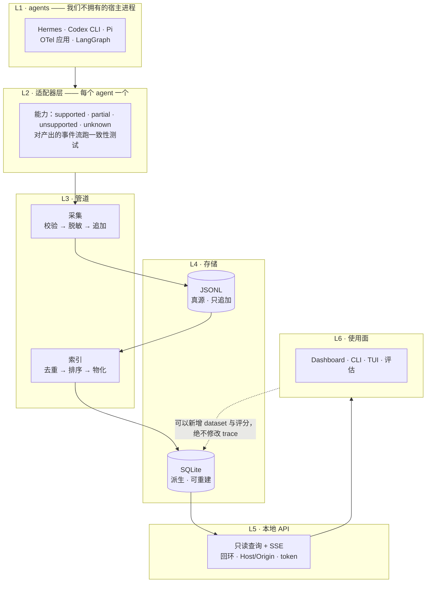

# agent-trace

[English](README.md) · [中文](README.zh-CN.md)

**面向 AI Agent 的 local-first 可观测与评估平台。** 追踪、调试、评估你的 agent，数据留在本机。

每一次模型调用、工具执行、子代理和失败都会写入本地 JSONL 流，索引进 SQLite，并有四种读取方式：命令行、实时 TUI 面板、浏览器 Dashboard，以及一套把历史运行变成可重复测试的评估框架。支持 **Hermes**、**Codex CLI**、**Pi**、**任何使用 OpenTelemetry 的应用**以及 **LangChain/LangGraph**。没有代理、没有云端、不需要账号。

```bash
bash install.sh all              # 安装适配器 + CLI
agenttrace serve --daemon        # 索引进程 + API + Dashboard，监听 127.0.0.1:8741
```

## 快速开始

```bash
bash install.sh hermes [profile|all]   # 也可以是 pi | codex | cli
hermes chat -q "Reply with exactly: OK"

agenttrace ls                      # 最近的记录
agenttrace watch                   # 同样的流量，实时面板
agenttrace session <id>            # 一次对话，每一轮的耗时
agenttrace report                  # 近期运行的效率信号
agenttrace serve                   # Dashboard
```

## 架构



那条**不存在的箭头**才是关键：**没有任何东西会写回 trace 流。** dataset 和评分是独立的表；一次已录制的执行是不可变的 —— 这正是几个月后重跑实验仍然可复现的原因。

## 架构原则

下面每一条都在代码里有强制点，不只是意图 —— 右列标出位置。

| 原则 | 具体做法 |
|---|---|
| **Local-first** | 数据不出本机：无云端、无账号、无遥测。回环绑定、`Host` 白名单、不发 CORS 头、检查 `Origin`、bearer token 权限 0600（`server/main.py`） |
| **契约是 wire format** | 是 `schema/events.schema.json`，不是某个语言的接口。Pi 适配器是 TypeScript，不 import 这里的任何东西也符合契约；一致性工具校验的是**产出的事件流**（`adapter_sdk/testing.py`） |
| **JSONL 是真源，索引是派生** | 索引损坏或过期就重建、绝不修补 —— 这也是转换器改进能到达已索引数据的方式（`core/storage/`、`agenttrace index --full`） |
| **先脱敏再落盘** | 脱敏在适配器内、追加之前完成。不存在"先写后擦"的路径（`core/privacy.py`、`common/agenttrace_common.py`） |
| **采集失败开放** | 丢一个事件可以接受，阻塞 agent 不行。sink 吞掉 I/O 错误并计数（`adapter_sdk/event_sink.py`） |
| **能力诚实** | 四级声明；缺失字段显示为「该接入方式未提供」，而不是空字符串（`adapter_sdk/capabilities.py`） |
| **要证据，不要分数** | 评估器返回证据与置信度；轨迹信号分开报告、永不加总（`evaluation/`） |
| **失败要可见** | 空 Dashboard 必须自己解释：覆盖率缺口、"索引仍在构建"、以及带路由名的错误（`core/coverage.py`、`server/static/app.js`） |

每条原则的由来（包括那些在 review 之后被推翻重来的）见 [docs/decisions.md](docs/decisions.md)。

## 命令

| | |
|---|---|
| `agenttrace ls` / `show` / `search` | 最近记录 · 一次调用的完整内容 · 跨内容 grep |
| `agenttrace sessions` / `stats` | 按 session 分组 · 按 agent/model 统计调用、token、错误 |
| `agenttrace session <id>` | 一次对话：每一轮各自的耗时 |
| `agenttrace report` | 轨迹信号 —— 重复重试、错误恢复、上下文膨胀 |
| `agenttrace watch` | agent 运行时的实时全屏面板 |
| `agenttrace serve` | 索引进程 + 本地 API + Dashboard（`--daemon`、`--status`、`--stop`） |
| `agenttrace index [--full]` | 从 JSONL 文件（重）建 SQLite 索引 |
| `agenttrace doctor` | 为什么没有数据：安装、采集、磁盘、丢弃的事件、索引 |
| `agenttrace adapter list\|test\|coverage` | 注册表 · 一致性测试 · 采集缺口 |
| `agenttrace otlp import\|export` | OTLP 导入与导出 |

筛选参数（`--agent --model --event --session --since --contains --limit`）和环境变量见 **[docs/usage.md](docs/usage.md)**。

## Dashboard

`agenttrace serve --daemon` 会索引所有已知 trace 目录，在 `http://127.0.0.1:8741` 提供服务，启动日志里给出一次性 token。新 trace 通过 SSE 实时推送。

**Overview**（错误、token、延迟）· **Traces**（搜索与筛选）· **Trace detail**（执行树 + waterfall、span 的输入/输出/错误、工作区、原始 JSON）· **Sessions → Session detail**（每一轮的耗时、占 agent 时间的比例、空档在哪里）· **Datasets / Experiments** · **Adapters**（声明能力 vs 实际观测、采集健康度、缺口）。

一个 trace 是**一轮** —— 这就是「一次任务执行」的含义 —— 所以"每次对话耗时"在 session 页面上。

## Hermes 里的 TUI

支持的最小终端宽度：24 列。

`./install.sh hermes` 将 `/agenttrace` 安装到 default profile 的
`tui-widgets/`。在 `hermes --tui` 中输入命令，四行卡片停靠显示，不接管输入框；再输入一次关闭。其他 profile 需显式执行 `./install.sh hermes <profile>`。

速览默认看**所有已索引 agent**，不会自动猜测当前对话。在 `/tracex` 中按 **p**，可将速览固定到选中的会话；按 **G** 切回全局。也可输入 `/agenttrace session <session-id> [server-url]` 或 `/agenttrace global [server-url]`。固定范围只保留在当前 TUI 进程中；点击卡片可打开对应会话，未固定时打开会话选择器。

累计轮数、token、`spanErr` 使用卡片标明的统计范围；错误数是 error/interrupted/cancelled span 数，不是失败轮数。`p50/N` 和走势线取最新 24 轮中已闭合且耗时已知的样本，不把未知值补零。`new` 表示开始时间最新的一轮，不是最近活动；耗时是已记录时间跨度，不是实时计时或纯计算时间。

Linux 上建议在仓库目录安装常驻服务：

```bash
python3 scripts/agenttrace-service.py install --dry-run
python3 scripts/agenttrace-service.py install
python3 scripts/agenttrace-service.py status
# 只移除本工具管理的服务：
python3 scripts/agenttrace-service.py uninstall
```

这是仅监听 loopback 的 systemd **用户服务**，异常退出自动重启，文件权限默认私有。`status` 会报告 lingering；未开启时，开机及退出登录后常驻需要管理员配置。不要和手动启动的 daemon 同时占用同一端口。其他平台仍可用 `agenttrace serve --daemon`。安装 widget 不会自动安装服务。

首次索引期间也能响应健康检查；卡片分别显示 `indexing`、采集问题数量和确实没有数据。每次请求完成后等 2.5 秒再刷新，不重叠，关闭后取消请求。HTTP 错误不伪装成零数据，认证刷新次数有限；失败保留上次成功数据，并标注 `STALE` 和数据年龄。所有阶段占四行。单凭超时不会推断正在索引。

`/widgets-reload` 可重新扫描安装副本。修改仓库后需先复制到
`<HERMES_HOME>/tui-widgets/agenttrace.mjs`，安装器可检查版本漂移。
`node scripts/widget-harness.mjs [server-url]` 对真实服务做无界面验证，
`node --test test/hermes-widget.test.mjs` 跑隔离回归测试。

### 详情浏览器 `/tracex`

`/tracex` 打开键盘操作面板：选择会话，Enter 查看该会话的轮次，再进入 span 父子执行树，选中 LLM 或工具调用后查看输入、输出、错误、模型、token 和隐私元数据。
`/tracex <session-id> [server-url]` 可绑定指定完整会话 ID。
Widget SDK 没有暴露当前聊天 ID，因此无参数时让你选会话，**不会把最近活动会话冒充当前会话**。

- 上下键或 j/k：选择、滚动；PageUp/PageDown：移动十行。
- Enter：进入；空格：折叠/展开节点；e：只看错误 span。
- b 或 Esc：返回；q：关闭；r：刷新当前快照。
- 调用详情内 i/o/x 跳到输入/输出/错误，g 回到元数据。
- / 打开不区分大小写的字面查找，Enter 应用、Esc 取消；详情中 n/N 循环跳到下一个/上一个匹配行。用 / 打开后 Ctrl+u 清空搜索词，再按 Enter，清除筛选。

`/` 只查找**已加载的快照**。会话列表里 **f** 对全索引搜索 ID、模型、工作目录和 adapter；**a**、**M**、**t** 分别设置精确 agent、精确模型和最近活动时间下限（ISO 日期或时间）。左右键翻页，每页 50 个会话，标题显示总数。清除某项条件：打开对应编辑器，Ctrl+u，再按 Enter。服务端按字面匹配 `%`、`_`，但不搜索完整调用正文。树查找包含折叠节点且不破坏折叠状态；详情支持跨显示折行的匹配，保留空白，最多跟踪 1,000 个匹配行。

**l** 切换实时／暂停，**m** 打开所选会话的诊断页，详情里 **v** 显示完整采集内容的导出命令，**?** 查看帮助。默认是暂停的快照；实时模式在每次请求结束后再轮询，按 ID 保持选中记录，编辑查找条件时不替换正在看的数据。失败保留旧数据并明确标记过期。返回保留筛选和选中项；从调用详情返回时重新获取轻量树元数据。切页或刷新后，旧响应不能覆盖新页面。

诊断页分别展示 LLM／工具的有效调用耗时 p50、p95、最大值和样本量，列出最慢的十次调用，以及 token／缓存读取总量。p95 至少需要五个样本；synthetic、未闭合和耗时未知的调用不混入样本。这里不是 TTFT，也不推算费用或吞吐；未知 token 分量仍显示未知。

执行树只取元数据，打开调用才获取该次正文。折行和匹配结果按记录身份缓存，并限制缓存大小。保留中文和 emoji，清除终端控制字符；每个详情区段显示上限 100,000 字符，截断会提示。需要完整**已落盘**内容时，可按 **v** 获取命令，或在仓库目录执行：

```bash
python3 scripts/export-span.py --trace TRACE_ID --span SPAN_ID --output span.json
```

导出工具只访问 loopback HTTP，读取现有本地 token，核对 trace/span ID，拒绝重定向和覆盖文件，输出权限为 `0600`。不会关闭采集时的脱敏；导出文件仍可能包含敏感信息。


## 评估

```bash
agenttrace report --limit 100 --verbose
```

把一次糟糕的运行变成回归测试，然后对整批打分：dataset 保存任务与预期结果（存指针，不复制 prompt 历史），experiment 钉住 dataset 版本、evaluator 版本和 agent 配置，运行采用 **playback** 评分 —— 对已录制的执行打分，而不是重新跑 agent。

| 评估器类型 | 例子 |
|---|---|
| deterministic | 测试是否通过 · 输出是否包含某内容 · 是否超出预算 · **agent 声称成功但最后一次测试其实失败** |
| trajectory | 相同失败调用重复 · 错误恢复 · 上下文增长但没有推进 · 首次操作延迟 |
| LLM-as-judge | 任务完成度，由**本地**端点评判（未配置 ⇒ 报"无信号"，绝不伪造判决） |

信号永远不会被加总成一个分数：重试可能是正确的恢复策略。模型没有配置价格时成本显示 `unknown`，而不是估算值。

## 适配器

内置五个：**hermes**、**codex**、**pi**、**otlp**、**langgraph**。能力用四级声明 —— `supported`、`partial`、`unsupported`、`unknown` —— 所以缺口显示为「该接入方式未提供此字段」，而不是空字符串。例如 codex 声明 `streaming: unsupported`，因为它的 rollout 文件是在完成后才写入的。

第三方适配器通过 manifest 或 entry point 被发现，**发现时不导入代码**；只有你显式要求时才执行。详见 [docs/adapters.md](docs/adapters.md) 与 [docs/writing-an-adapter.md](docs/writing-an-adapter.md)。

## 「装好了，但什么都没有」

```bash
agenttrace doctor                   # 一次列出所有可能原因，有问题时退出码 1
agenttrace doctor --json            # 同样的检查，给脚本用
```

它检查造成空页面的八件事：目录不可写、磁盘没空间、最近没有记录、schema 版本未知、部署的插件是旧拷贝、索引落后于文件、采集路径写失败的事件、agent 跑过但没有 trace 的会话。每条警告都给出对应的修复命令。

适配器在其宿主进程启动时加载，所以对已经在运行的会话不起作用 —— 需要重启 agent，Pi 可以 `/reload`。Dashboard 会自己说明这一点：

```bash
agenttrace adapter coverage         # 缺什么、为什么缺（有近期缺口时退出码 1）
```

它把每个 agent 留下的会话证据与「我们有 trace 的会话」比对，并按适配器安装时间分年龄段：安装**之后**启动却无 trace 的是缺陷，安装之前的属于历史、是回填候选。

```bash
python3 pi/pi_import.py             # Pi：恢复所有没有 live trace 的会话
python3 codex/codex_import.py <rollout.jsonl>
```

回填记录带有标记和独立命名空间，不会被误认为实时观测；请求侧从 transcript 重建，记录里也写明了这一点。

## 隐私

* 数据不离开本机：没有云端、没有账号、没有遥测。
* 脱敏在适配器内、落盘之前完成（`AGENTTRACE_REDACT=0` 关闭）；`AGENTTRACE_CAPTURE=metadata` 保留结构而去掉正文。密钥是在序列化**之前**从记录的字段值里清掉的，而不是在成品 JSON 行上跑正则 —— 后者会让一条记录不再能被解析。
* 写不进去的事件不会静默消失：每个适配器、每种失败类型最多每分钟一行，落在 `~/.agenttrace/ingest-faults.jsonl`（在所有 trace 目录之外，上限 256 KiB），`agenttrace doctor` 会报出来。
* 本地 API **不被默认为可信**：仅绑定回环、`Host` 白名单（防 DNS rebinding）、不发送 CORS 头、检查 `Origin`、bearer token 权限 0600。
* 工作区采集是只读的，绝不拿你的 git index 锁；diff 默认不抓（`AGENTTRACE_GIT=full` 才开启），并且快照会记录读取时刻，避免几个月前的 trace 被当成本地当前分支去解读。

目前**刻意还没有**：保留期限与自动删除、真正的 agent 重放（目前只有 playback）、跨机器聚合。删除一条 trace 就是删掉它的 JSONL —— 索引会在下一次扫描时跟着更新，文件消失则对应的行一并消失。每个决策的理由在 [docs/decisions.md](docs/decisions.md)。

## 开发

```bash
test/run-all.sh                    # 全部测试（SKIP_E2E=1 跳过真实模型调用）
.venv/bin/ruff check . && .venv/bin/mypy
cd pi && npm ci && npm run typecheck
```

约 29 个测试文件：每个适配器的 fixture、一致性测试工具、Dashboard 路由测试、两个端到端测试，以及 `test/review-fixes.test.py` —— 它保存了各轮 review 的全部发现，**包括那些由修复本身引入的问题**。CI 在每次 push 时运行 lint、类型检查和完整套件。
