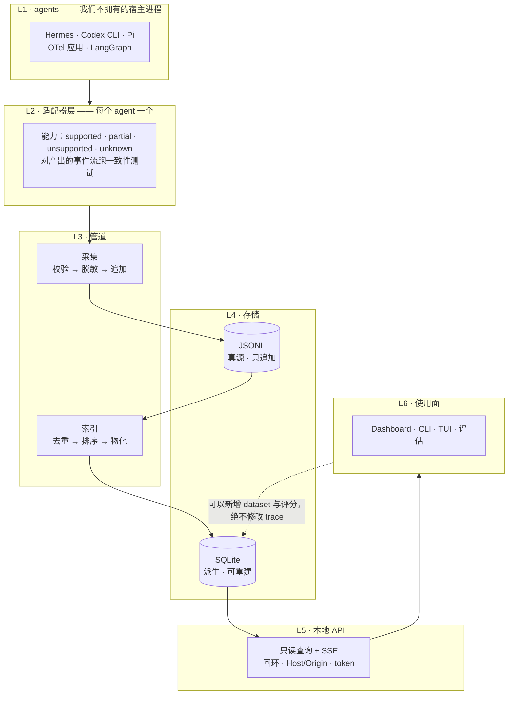

# agent-trace

[English](README.md) · [中文](README.zh-CN.md)

**面向 AI Agent 的 local-first 可观测与评估平台。** 追踪、调试、评估你的 agent，数据留在本机。

每一次模型调用、工具执行、子代理和失败都会写入本地 JSONL 流，索引进 SQLite，并有四种读取方式：命令行、实时 TUI 面板、浏览器 Dashboard，以及一套把历史运行变成可重复测试的评估框架。支持 **Hermes**、**Codex CLI**、**Pi**、**任何使用 OpenTelemetry 的应用**以及 **LangChain/LangGraph**。没有代理、没有云端、不需要账号。

```bash
bash install.sh all              # 安装适配器 + CLI
agenttrace serve --daemon        # 索引进程 + API + Dashboard，监听 127.0.0.1:8741
```

## 快速开始

```bash
bash install.sh hermes [profile|all]   # 也可以是 pi | codex | cli
hermes chat -q "Reply with exactly: OK"

agenttrace ls                      # 最近的记录
agenttrace watch                   # 同样的流量，实时面板
agenttrace session <id>            # 一次对话，每一轮的耗时
agenttrace report                  # 近期运行的效率信号
agenttrace serve                   # Dashboard
```

## 架构



那条**不存在的箭头**才是关键：**没有任何东西会写回 trace 流。** dataset 和评分是独立的表；一次已录制的执行是不可变的 —— 这正是几个月后重跑实验仍然可复现的原因。

## 架构原则

下面每一条都在代码里有强制点，不只是意图 —— 右列标出位置。

| 原则 | 具体做法 |
|---|---|
| **Local-first** | 数据不出本机：无云端、无账号、无遥测。回环绑定、`Host` 白名单、不发 CORS 头、检查 `Origin`、bearer token 权限 0600（`server/main.py`） |
| **契约是 wire format** | 是 `schema/events.schema.json`，不是某个语言的接口。Pi 适配器是 TypeScript，不 import 这里的任何东西也符合契约；一致性工具校验的是**产出的事件流**（`adapter_sdk/testing.py`） |
| **JSONL 是真源，索引是派生** | 索引损坏或过期就重建、绝不修补 —— 这也是转换器改进能到达已索引数据的方式（`core/storage/`、`agenttrace index --full`） |
| **先脱敏再落盘** | 脱敏在适配器内、追加之前完成。不存在"先写后擦"的路径（`core/privacy.py`、`common/agenttrace_common.py`） |
| **采集失败开放** | 丢一个事件可以接受，阻塞 agent 不行。sink 吞掉 I/O 错误并计数（`adapter_sdk/event_sink.py`） |
| **能力诚实** | 四级声明；缺失字段显示为「该接入方式未提供」，而不是空字符串（`adapter_sdk/capabilities.py`） |
| **要证据，不要分数** | 评估器返回证据与置信度；轨迹信号分开报告、永不加总（`evaluation/`） |
| **失败要可见** | 空 Dashboard 必须自己解释：覆盖率缺口、"索引仍在构建"、以及带路由名的错误（`core/coverage.py`、`server/static/app.js`） |

每条原则的由来（包括那些在 review 之后被推翻重来的）见 [docs/decisions.md](docs/decisions.md)。

## 命令

| | |
|---|---|
| `agenttrace ls` / `show` / `search` | 最近记录 · 一次调用的完整内容 · 跨内容 grep |
| `agenttrace sessions` / `stats` | 按 session 分组 · 按 agent/model 统计调用、token、错误 |
| `agenttrace session <id>` | 一次对话：每一轮各自的耗时 |
| `agenttrace report` | 轨迹信号 —— 重复重试、错误恢复、上下文膨胀 |
| `agenttrace watch` | agent 运行时的实时全屏面板 |
| `agenttrace serve` | 索引进程 + 本地 API + Dashboard（`--daemon`、`--status`、`--stop`） |
| `agenttrace index [--full]` | 从 JSONL 文件（重）建 SQLite 索引 |
| `agenttrace adapter list\|test\|coverage` | 注册表 · 一致性测试 · 采集缺口 |
| `agenttrace otlp import\|export` | OTLP 导入与导出 |

筛选参数（`--agent --model --event --session --since --contains --limit`）和环境变量见 **[docs/usage.md](docs/usage.md)**。

## Dashboard

`agenttrace serve --daemon` 会索引所有已知 trace 目录，在 `http://127.0.0.1:8741` 提供服务，启动日志里给出一次性 token。新 trace 通过 SSE 实时推送。

**Overview**（错误、token、延迟）· **Traces**（搜索与筛选）· **Trace detail**（执行树 + waterfall、span 的输入/输出/错误、工作区、原始 JSON）· **Sessions → Session detail**（每一轮的耗时、占 agent 时间的比例、空档在哪里）· **Datasets / Experiments** · **Adapters**（声明能力 vs 实际观测、采集健康度、缺口）。

一个 trace 是**一轮** —— 这就是「一次任务执行」的含义 —— 所以"每次对话耗时"在 session 页面上。

## 评估

```bash
agenttrace report --limit 100 --verbose
```

把一次糟糕的运行变成回归测试，然后对整批打分：dataset 保存任务与预期结果（存指针，不复制 prompt 历史），experiment 钉住 dataset 版本、evaluator 版本和 agent 配置，运行采用 **playback** 评分 —— 对已录制的执行打分，而不是重新跑 agent。

| 评估器类型 | 例子 |
|---|---|
| deterministic | 测试是否通过 · 输出是否包含某内容 · 是否超出预算 · **agent 声称成功但最后一次测试其实失败** |
| trajectory | 相同失败调用重复 · 错误恢复 · 上下文增长但没有推进 · 首次操作延迟 |
| LLM-as-judge | 任务完成度，由**本地**端点评判（未配置 ⇒ 报"无信号"，绝不伪造判决） |

信号永远不会被加总成一个分数：重试可能是正确的恢复策略。模型没有配置价格时成本显示 `unknown`，而不是估算值。

## 适配器

内置五个：**hermes**、**codex**、**pi**、**otlp**、**langgraph**。能力用四级声明 —— `supported`、`partial`、`unsupported`、`unknown` —— 所以缺口显示为「该接入方式未提供此字段」，而不是空字符串。例如 codex 声明 `streaming: unsupported`，因为它的 rollout 文件是在完成后才写入的。

第三方适配器通过 manifest 或 entry point 被发现，**发现时不导入代码**；只有你显式要求时才执行。详见 [docs/adapters.md](docs/adapters.md) 与 [docs/writing-an-adapter.md](docs/writing-an-adapter.md)。

## 「装好了，但什么都没有」

适配器在其宿主进程启动时加载，所以对已经在运行的会话不起作用 —— 需要重启 agent，Pi 可以 `/reload`。Dashboard 会自己说明这一点：

```bash
agenttrace adapter coverage         # 缺什么、为什么缺（有近期缺口时退出码 1）
```

它把每个 agent 留下的会话证据与「我们有 trace 的会话」比对，并按适配器安装时间分年龄段：安装**之后**启动却无 trace 的是缺陷，安装之前的属于历史、是回填候选。

```bash
python3 pi/pi_import.py             # Pi：恢复所有没有 live trace 的会话
python3 codex/codex_import.py <rollout.jsonl>
```

回填记录带有标记和独立命名空间，不会被误认为实时观测；请求侧从 transcript 重建，记录里也写明了这一点。

## 隐私

* 数据不离开本机：没有云端、没有账号、没有遥测。
* 脱敏在适配器内、落盘之前完成（`AGENTTRACE_REDACT=0` 关闭）；`AGENTTRACE_CAPTURE=metadata` 保留结构而去掉正文。
* 本地 API **不被默认为可信**：仅绑定回环、`Host` 白名单（防 DNS rebinding）、不发送 CORS 头、检查 `Origin`、bearer token 权限 0600。
* 工作区采集是只读的，绝不拿你的 git index 锁；diff 默认不抓（`AGENTTRACE_GIT=full` 才开启），并且快照会记录读取时刻，避免几个月前的 trace 被当成本地当前分支去解读。

目前**刻意还没有**：保留期限与自动删除、删除单条 trace/session、真正的 agent 重放（目前只有 playback）、跨机器聚合。每个决策的理由在 [docs/decisions.md](docs/decisions.md)。

## 开发

```bash
test/run-all.sh                    # 全部测试（SKIP_E2E=1 跳过真实模型调用）
.venv/bin/ruff check . && .venv/bin/mypy
cd pi && npm ci && npm run typecheck
```

约 29 个测试文件：每个适配器的 fixture、一致性测试工具、Dashboard 路由测试、两个端到端测试，以及 `test/review-fixes.test.py` —— 它保存了各轮 review 的全部发现，**包括那些由修复本身引入的问题**。CI 在每次 push 时运行 lint、类型检查和完整套件。
